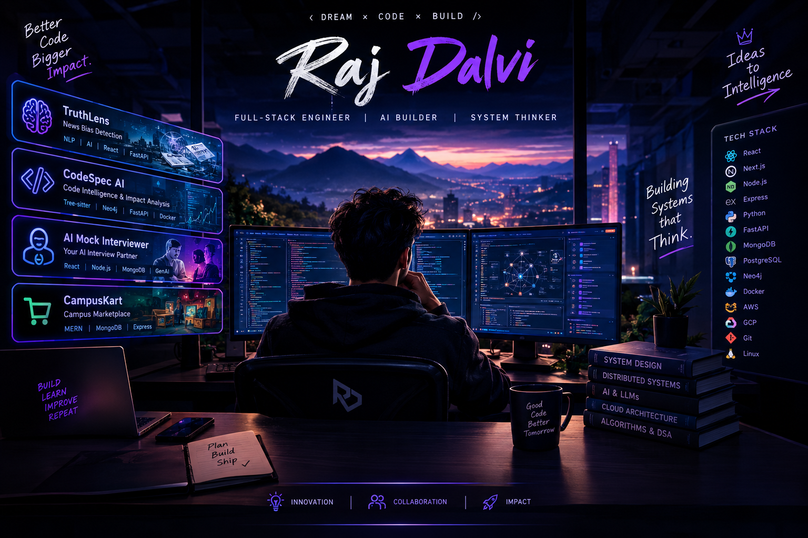

# Raj Dalvi | Software Developer & AI Builder

\<div align="center">

\

\<br/>

\

\<br/>

**Software Developer · Full-Stack Engineer · AI Builder**

*Turning complex ideas into useful, intelligent software.*

\<br/>

\<a href="[https://github.com/RajDalvi08](https://github.com/RajDalvi08)">
\
\</a>
\<a href="[https://www.linkedin.com/in/raj-dalvi-400535331/](https://www.linkedin.com/in/raj-dalvi-400535331/)">
\
\</a>
\<a href="mailto\:rajdalvi.dev\@gmail.com">
\
\</a>

\<br/>\<br/>

\

\</div>

---

## 01. About Me

```yaml
name: Raj Dalvi
education: B.E. Information Technology
graduation: 2027

interests:
  - Full-Stack Development
  - Artificial Intelligence
  - Backend Engineering
  - Software Architecture
  - Problem Solving

currently:
  - Building real-world applications
  - Exploring AI-powered systems
  - Learning scalable backend architecture

mindset: Learn → Build → Break → Debug → Improve
```

I'm an Information Technology student passionate about building software that solves meaningful problems.

I enjoy working across the development lifecycle — designing interfaces, developing APIs, managing databases, integrating AI capabilities and understanding how different components work together.

I believe good engineering is not just about writing code. It's about understanding the problem, designing the right solution and building something that actually works.

---

## 02. Featured Projects

### ◈ TruthLens

**AI-Powered Media Analysis**

Analyzing news content through NLP and intelligent analysis to explore linguistic framing, potential bias patterns and generate meaningful insights.

`React` `Python` `FastAPI` `NLP` `Machine Learning`

\<a href="[https://github.com/RajDalvi08/Truthlens](https://github.com/RajDalvi08/Truthlens)">↗ Explore Repository\</a>

---

### ◈ CodeSpec AI

**AI-Powered Codebase Intelligence**

Working on an intelligent codebase analysis system that explores repository structures, extracts source-code relationships and builds dependency graphs to understand software architecture.

`FastAPI` `Python` `Tree-sitter` `Neo4j` `Qdrant` `Redis` `Celery`

\<a href="[https://github.com/RajDalvi08](https://github.com/RajDalvi08)">↗ Explore My GitHub\</a>

---

### ◈ Flood Detection & Monitoring System

**IoT × Real-Time Monitoring × Firebase**

A real-time flood monitoring solution combining ESP32 hardware, ultrasonic sensing and a web dashboard to monitor water levels and generate alerts.

- Live sensor data monitoring
- Firebase Realtime Database integration
- Water-level classification
- Flood warning notifications
- Interactive monitoring dashboard

`React` `TypeScript` `ESP32` `Firebase` `IoT`

\<a href="[https://github.com/RajDalvi08/Flood-Detection](https://github.com/RajDalvi08/Flood-Detection)">↗ Explore Repository\</a>

---

### ◈ AI Mock Interviewer

**AI × Interview Preparation**

An application concept designed to help candidates prepare for interviews using resume information, job descriptions, AI-generated questions and performance feedback.

`React` `Node.js` `MongoDB` `Generative AI`

\<a href="[https://github.com/RajDalvi08/AI-mock-interviewer](https://github.com/RajDalvi08/AI-mock-interviewer)">↗ Explore Repository\</a>

---

### ◈ CampusKart

**Full-Stack Student Marketplace**

A student-focused marketplace concept that connects buyers and sellers through a centralized platform.

`MongoDB` `Express.js` `React` `Node.js`

---

### ◈ Ochi Landing Page

**Creative Frontend Engineering**

A modern creative-agency landing page focused on interactive interfaces, animations and visual storytelling.

`React` `Tailwind CSS` `Framer Motion`

\<a href="[https://github.com/RajDalvi08/ochi-landing-page](https://github.com/RajDalvi08/ochi-landing-page)">↗ Explore Repository\</a>

---

## 03. Tech Stack

\<div align="center">

### Languages

\

### Frontend Development

\

### Backend & Databases

\

### AI & Machine Learning

\

### Tools & Infrastructure

\

\</div>

---

## 04. Engineering Interests

| Domain           | Areas of Interest                              |
| :--------------- | :--------------------------------------------- |
| Frontend         | React, UI Engineering, Animations              |
| Backend          | REST APIs, Authentication, Server Architecture |
| AI Engineering   | LLMs, NLP, Code Intelligence                   |
| Databases        | SQL, NoSQL, Data Modeling                      |
| System Design    | Scalability, Distributed Systems               |
| Infrastructure   | Docker, Cloud, Deployment                      |
| Computer Science | DSA, Algorithms, Problem Solving               |

---

## 05. GitHub Analytics

\<div align="center">

\

\

\<br/>\<br/>

\

\<br/>\<br/>

\

\</div>

---

## 06. Currently Exploring

```text
01  SYSTEM DESIGN          → Designing scalable applications
02  AI ENGINEERING         → Building intelligent applications
03  DISTRIBUTED SYSTEMS    → Understanding systems at scale
04  BACKEND ARCHITECTURE   → Building reliable APIs
05  ADVANCED DSA           → Strengthening problem-solving skills
06  CLOUD INFRASTRUCTURE   → Understanding deployment and DevOps
```

---

## 07. Beyond The Code

I enjoy experimenting with new technologies, contributing to development projects, understanding how existing systems work and turning challenging ideas into working implementations.

My development philosophy:

> Don't just learn a technology. Understand it, build with it, break it, and make it better.

---

\<div align="center">

## Let's Build Something Meaningful.

**Ideas are everywhere. Engineering brings them to life.**

\<br/>

\<a href="[https://github.com/RajDalvi08](https://github.com/RajDalvi08)"> \ \</a> \<a href="[https://www.linkedin.com/in/raj-dalvi-400535331/](https://www.linkedin.com/in/raj-dalvi-400535331/)"> \ \</a>

\<br/>\<br/>

\

**BUILDING • LEARNING • SHIPPING**

\</div>
